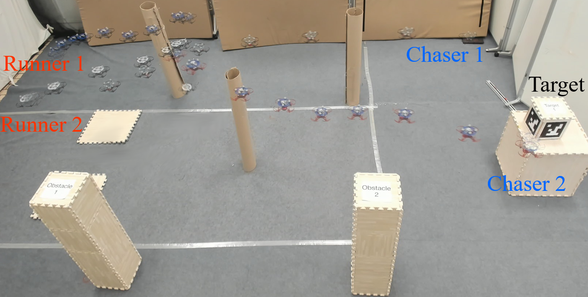
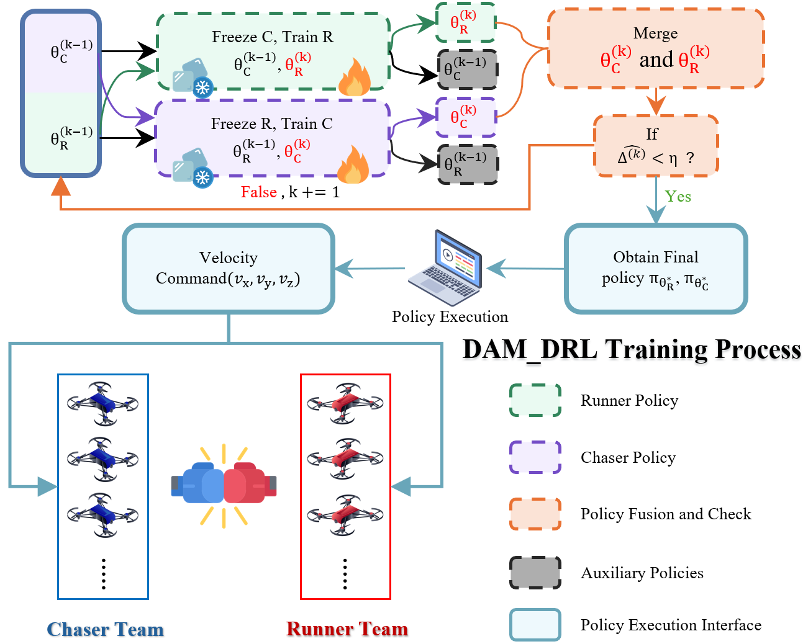

# Learning Continuous Obstacle-Rich Pursuit for Drone Swarms

**IROS 2026 | DAM-DRL**

Project page for **Dual-stabilized Asynchronous Multi-stage Deep Reinforcement Learning (DAM-DRL)**.

This repository shares the core Unity scripts, prefabs, and model assets associated with the work.

## Real-world experimental setup

*Real-world 2-vs-2 pursuit-evasion experiment. Overlaid drone positions illustrate the trajectories around obstacles and the marked target.*

## Overview

Autonomous drone interception in obstacle-rich environments requires agents to respond to adaptive opponents while coordinating with teammates and avoiding collisions. In these competitive pursuit-evasion settings, strong opponents can suppress learning signals, while simultaneous policy updates can destabilize training.

DAM-DRL addresses these challenges through progressive multi-stage training and an alternating freeze-train-merge mechanism. The framework regulates adversarial co-evolution to support stable learning of pursuit and evasion policies.

## Method

*Alternating frozen-opponent training, policy merging, stage-stability checking, and execution of the learned policies.*

The training framework combines three components:

1. **Dual cold-start:** establish initial policies for both chasers and runners under simplified conditions.
2. **Alternating freeze-and-train:** hold one team's policy fixed while training the opposing team.
3. **Policy merging:** combine the trained policies to initialize the next training stage.

Together, these components control the growth of adversarial strength across training stages.

## Simulation and real-world demonstrations

The paper evaluates DAM-DRL in obstacle-rich drone pursuit-evasion simulations, with comparisons against representative learning-based and planning-based methods. Physical flight experiments further demonstrate deployment of the learned policies on real UAVs.

https://github.com/user-attachments/assets/bcadc8e6-aeab-4e4b-bed5-0b3acf8a0a9c

https://github.com/user-attachments/assets/e1b90216-99b1-41d3-a59f-a77db4393ced

The video presents the simulation experiment first, followed by the real-world 2-vs-2 flight experiment.

<!-- For an inline GitHub video player, replace the linked preview and watch link above with the attachment URL generated by dragging assets/videos/dam_drl_demo.mp4 into GitHub's README editor. Put the generated URL on its own line. -->

## Repository contents

| Directory | Contents |
| --- | --- |
| `Scripts/` | Unity C# source files |
| `Prefabs/` | Unity prefab assets |
| `model/` | Model assets and associated files |
| `assets/` | Experimental scene image, DAM-DRL flowchart, and demonstration video |

Unity scene files and a preconfigured Unity project are not included. Users need to assemble their own scene and configure the required dependencies and object references.

## Using the provided assets

1. Create a Unity project and install the packages required by the provided scripts.
2. Copy `Scripts/` and `Prefabs/` into the project's `Assets/` directory. Preserve the accompanying `.meta` files and directory structure.
3. Create a scene, add the required prefab instances, and configure the scene objects and Inspector references used by the scripts. Resolve any additional asset dependencies referenced by the prefabs.
4. When using a model from `model/`, assign it to the corresponding component and ensure that the scene, observation inputs, and action definitions match the model's requirements.

<!-- Add the verified paper link and complete BibTeX citation when available. -->

## License

See [LICENSE](LICENSE) for the MIT license.

